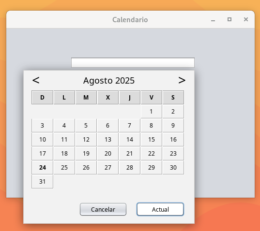

# CalendarPopup

**Un selector de fecha simple para aplicaciones Java Swing.**

`CalendarPopup` es un componente ligero y fácil de usar que muestra un campo de texto y despliega un calendario emergente al hacer clic. Permite personalizar colores, formatos de fecha y registrar eventos para reaccionar a la selección de una fecha.  

---

## 🖼 Muestra CalendarPopup

<p align="center">
  
</p>

## ✨ Características

- Selector de fecha intuitivo para Swing.
- Personalización de colores (texto, fondo, encabezados, etc.).
- Formatos de fecha configurables (`yyyy-MM-dd`, `dd-MM-yyyy`, `dd-MMM-yyyy`, etc.).
- Registro de eventos mediante la interfaz `Event`.
- Implementación ligera en Java puro, sin dependencias externas.
- Distribuido bajo licencia **MIT**.

---

## ⚙️ Requisitos

- **Java 8** o superior.  
- **Swing** (incluido en Java SE).  
- No requiere librerías externas.

---

## 📦 Instalación

### Opción 1: Maven (Recomendada)
Agrega el repositorio de JitPack y la dependencia en tu `pom.xml`:

```xml
<repositories>
    <repository>
        <id>jitpack.io</id>
        <url>[https://jitpack.io](https://jitpack.io)</url>
    </repository>
</repositories>

<dependencies>
    <dependency>
        <groupId>com.github.serchlr</groupId>
        <artifactId>CalendarPopup</artifactId>
        <version>v1.0.1</version>
    </dependency>
</dependencies>
```

### Opción 2: Gradle
Agrega JitPack en tu build.gradle (al final de los repositorios) y luego la dependencia:
```xml
repositories {
    mavenCentral()
    maven { url '[https://jitpack.io](https://jitpack.io)' }
}

dependencies {
    implementation 'com.github.serchlr:CalendarPopup:v1.0.1'
}
```

### Opción 3: Manual
1. Clona este repositorio:  

	 ```bash
	 git clone https://github.com/serchlr/CalendarPopup.git

2. Compila el proyecto y genera el .jar (o usa directamente el código fuente en tu proyecto).

3. Añade el .jar a tu classpath:

	NetBeans/Eclipse:
	Clic derecho sobre tu proyecto → Propiedades → Bibliotecas → Agregar JAR.

4. O descarga la versión complilada de los release o de la carpeta dist.

## 🚀 Ejemplo de uso

	import CalendarPopup.CalendarPopup;
	import CalendarPopup.Event;
	import javax.swing.*;
	import java.time.format.DateTimeFormatter;
	
	public class DemoCalendarPopup {
	    public static void main(String[] args) {
	        SwingUtilities.invokeLater(() -> {
	            JFrame frame = new JFrame("Demo CalendarPopup");
	            frame.setDefaultCloseOperation(JFrame.EXIT_ON_CLOSE);
	
	            // Crear el componente
	            CalendarPopup calendar = new CalendarPopup();
	            
	            // Configurar formato de fecha
	            calendar.setFormatDate(CalendarPopup.DD_MM_YYYY);
	
	            // Registrar un evento cuando cambie la fecha
	            calendar.setEvent(new Event() {
	                @Override
	                public void onDateChanged() {
	                    System.out.println("Fecha seleccionada: " + 
	                        calendar.getDate().format(DateTimeFormatter.ofPattern(CalendarPopup.DD_MM_YYYY)));
	                }
	            });
	
	            // Añadir el calendario al JFrame
	            frame.getContentPane().add(calendar);
	
	            frame.pack();
	            frame.setLocationRelativeTo(null);
	            frame.setVisible(true);
	        });
	    }
	}

## 🎨 Personalización

Puedes cambiar fácilmente los colores del calendario y del campo de texto, por ejemplo:

	calendar.setCPBackgroundColor(Color.LIGHT_GRAY);
	calendar.setCPTxtBackgroundColor(Color.WHITE);
	calendar.setCPTxtForegroundColor(Color.BLUE);
	calendar.setCPTitleForegroundColor(Color.RED);

Puedes implementar un evento al seleccionar el día utilizando la interfaz Event:

	calendar.setEvent(CalendarPopup.Event);

## 📖 Formatos de fecha disponibles

Constantes predefinidas en CalendarPopup:

	LONG_DATE → "EEEE, dd 'de' MMMM 'de' yyyy"
	YYYY_MM_DD → "yyyy-MM-dd"
	DD_MM_YYYY → "dd-MM-yyyy"
	DD_MMM_YYYY → "dd-MMM-yyyy"
	DD_MMMM_YYYY → "dd-MMMM-yyyy"

También puedes definir un formato personalizado:

	calendar.setPersonalFormatDate("MM/dd/yyyy");
	calendar.setFormatDate(calendar.getPersonalFormatDate());

## 🤝 Contribuciones

¡Todas las contribuciones son bienvenidas! Para colaborar:

	Haz un fork del repositorio.
	Crea una rama (git checkout -b feature/nueva-funcionalidad).
	Realiza tus cambios y haz commit (git commit -m "Agrega nueva funcionalidad").
	Abre un Pull Request.

## 📝 Historial de versiones

- *v1.0.1* – 17 de octubre de 2026 – Integración en JitPack
- *v1.0.0* – 13 de agosto de 2025 – Versión inicial.

## 📄 Licencia

Este proyecto está bajo la licencia MIT
